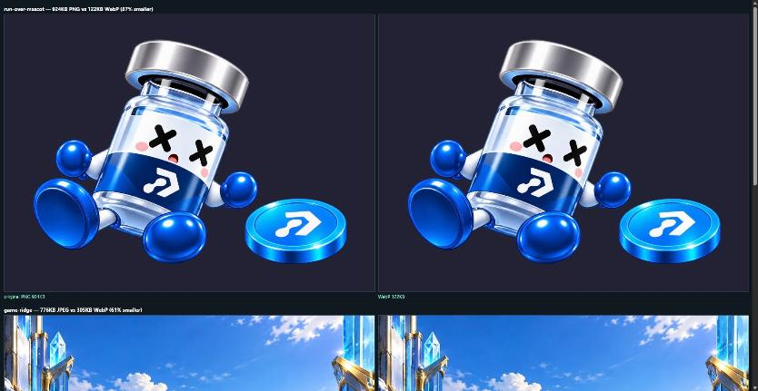

# PH Arcade — mobile audit, 20 October 2026

Audited the real build (`arcade/dev-server.mjs`, `node arcade/build.mjs` output) at **320x568, 360x640,
390x844 and 430x932** portrait, plus **844x390** landscape, signed in and signed out. Pages covered:
`#play`, Peak Blocks, Sequence, Ridge Run, My Bottle, the sign-in / invite screen, the "no plays left"
coin dialog, leaderboards (`#ranks`), prizes and the burger menu.

Each finding is marked **BUG** (clearly broken, fixed in this PR) or **CHOICE** (changes look or
behaviour, left for Billy).

A note on method: measurements were taken in-page rather than by eye — element rects against the
viewport, computed styles, and the real payload sizes off the dev server. Three things that *looked*
broken in the source turned out to be fine once measured, and are recorded at the bottom so nobody
re-opens them.

---

## Layout and safe areas

**1. BUG — The shell ignores the left/right safe-area insets, so in landscape the notch covers
controls.**
Where: `arcade/ui/styles.css` — `.brand-header` (`padding-inline:18px` at the phone breakpoint),
`main,.page-footer` (`padding:0 var(--gutter)`, gutter 16px), `.main-nav` (`padding:3px 10px ...`).
Size: any, but it only bites in **landscape** on a notched iPhone (the notch eats ~44px of one side).
The page sets `viewport-fit=cover`, which is what lets content run under the notch in the first place,
and then only ever compensates for `safe-area-inset-bottom`. The burger button, the breadcrumbs and the
end nav items are the ones that land under it.
Fix: add `max(..., env(safe-area-inset-left/right))` to those three paddings.

**2. CHOICE — Peak Blocks in landscape shrinks the board to 18px cells.**
Where: the Blocks scene. Size: 844x390. Rotating mid-game works correctly — the board re-fits from
354px to 195px, nothing is cut off, the tray stays visible and the page does not scroll — but a cell
goes from 38px to **18px**, which is small to hit accurately.
Fix if wanted: a landscape layout that puts the tray beside the board instead of under it, so the board
can use the full height. This is a real layout design, not a tweak.

**3. Clean — no horizontal scroll or overflow anywhere.**
Checked every page at all four portrait sizes and in landscape: `documentElement.scrollWidth` never
exceeded the viewport, and no visible element's right edge crossed it. Nothing to do.

---

## Touch behaviour

**4. BUG — The Peak Blocks board does not claim the touch, so dragging on it can scroll the page.**
Where: `dist/gameplay.css`. Size: all. `.block-tray` has `touch-action:none`, but `.block-board` and
the scene around it compute to `touch-action:auto`. A drag that starts on the board — which is most
drags, once a piece is picked up and moved — is still a candidate for page scroll, rubber-banding and
pull-to-refresh on iOS.
Fix: `touch-action:none` on the board and the Blocks scene.

**5. BUG — Nothing suppresses text selection or the iOS long-press menu on the game surfaces.**
Where: `dist/gameplay.css` / `dist/styles.css`. Size: all. Every game surface computes to
`user-select:auto` and `-webkit-touch-callout` is never set. Holding a piece still for a moment — which
is exactly what happens while you think about where to drop it — can raise the selection handles or the
callout menu on iOS.
Fix: `user-select:none` and `-webkit-touch-callout:none` on the board, tray and canvas.

**6. BUG — `overscroll-behavior` is set on `body` but not `html`.**
Where: `dist/styles.css`. Size: all. `body` computes to `overscroll-behavior:none`, `html` to `auto`.
The scroll chain starts at the document element, so the guard is only reliable when it is on `html`
too; as it stands a pull-down that begins over a non-tray part of the game can still rubber-band.
Fix: put `overscroll-behavior:none` on `html` as well.

**7. BUG — Several shell buttons are just under the 44px minimum.**
Where: `arcade/ui/styles.css`, `arcade/ui/play.css`. Size: all four, identically. Measured:

| Control | Size | Where |
| --- | --- | --- |
| `.icon-button` (burger, bag) | 42 x 42 | header, every page |
| `.primary` ("Play" on a game card) | 42 tall | `#play` |
| `.filter-tabs` / `.period-switch` buttons | 28–32 tall | `#play`, `#ranks` |
| `.customise-link` | 40 tall | `#play` |
| `.secondary` ("Get extra tries") | 37 tall | My Bottle |

Fixed where a `min-height` reaches 44px without disturbing the layout: `.icon-button` (now 44x44),
`.extra-plays` (now 44), `.secondary`, `.period-switch button`, `.daily-play-button`,
`.customise-link`. Re-measured at all four sizes and in landscape afterwards: no new overflow, no
horizontal scroll.

Three leaderboard filter tabs on `#play` are still **28px tall** after this. They are rendered by
`boardTabs()` into `.shortcut-filters` and the height comes from the container rather than the button,
so forcing 44px means changing that row's layout, not adding a `min-height`. Moved to finding 8.

**8. CHOICE — The controls whose 44px target needs a layout change, not a `min-height`.**
Measured after the fixes in finding 7, at 390x844:

| Control | Size | Why it needs a decision |
| --- | --- | --- |
| `#play` leaderboard filter tabs | 104x28, 68x28, 57x28 | height set by `.shortcut-filters`, not the button |
| breadcrumbs "Home" / "Arcade" | 34x18 / 42x18 | inline links; 44px changes header spacing |
| `.rule-link` "Prize rules apply." | 93x17 | inline link under the prize cards |
| `.text-link` "See full ranks" | 89x17 | inline link |
| `.swatch` (bottle colours) | 31x31 | round swatches; 44px changes the row |
| `.lock-button` | 27x27 | round badge on a 93px-tall card |
| `.collection-card .secondary` | 63x30 | inside a 93px card; 44px overflows it |
| `.footer-signout` | 39x15 | inline text link in the footer |

Each is a real miss against the 44px guideline; each costs a visual change to fix.

**9. CHOICE — Peak Blocks cells are 38px.**
Where: the Blocks board. Size: 390x844 (38px); 320x568 is smaller again. Below the 44px guideline, but
a board cell's size is set by fitting 8 columns into the screen — raising it means a smaller board or a
scrolling board.

---

## Inputs

**10. Clean — no input triggers the iOS focus zoom.**
Every `input` on the sign-in, invite and My Bottle screens computes to **16px** and 44px tall at all
four sizes. The `.name-input input` rules that set 12px and 13px inside the `max-width:700px` block are
overridden by a later 16px rule, so they never apply on a phone. Nothing to do — recorded because the
source reads as if it were broken.

**11. CHOICE — The sign-in submit button sits below the keyboard.**
Where: the invite tab of the sign-in screen (3 fields). Sizes: submit bottom is 705px of 568px at
320x568, and 688px of 844px at 390x844; a ~300px keyboard leaves 268px and 544px visible respectively.
The page scrolls and iOS pulls the focused field into view, so it is reachable, but after filling the
last field the button needs a scroll to reach.
Fix if wanted: `scroll-margin-bottom` on the fields, or a sticky submit bar. Both change the layout.

**12. CHOICE — The invite-code field has no `inputmode` or `autocapitalize`.**
Where: `#join-code`. Codes are upper case (`BILLY-TEST`, `PEAK-FRIENDS`) but the field opens a normal
lower-case keyboard. `autocapitalize="characters"` would match. Behaviour change, so your call.

---

## Text

**13. CHOICE — A lot of copy is under 14px, some very far under.**
Where: `#play` and the other shell pages, every size. Measured at 390x844: `PLAY • EARN • WIN` **7px**,
`.eyebrow` ("MONTHLY WINNER") **8.4px**, "FREE PRODUCT" **10.9px**, "Your choice." **10px**, "Prize
rules apply." **10px**, `PH ARCADE` strip **10px**, breadcrumbs **12px**, "Play free. Win product."
**12px**, "3 free plays per game, every day." **13px**. In the games: `SCORE` / `LINES` / `COMBO`
labels **11px**.
Several of these are deliberate typographic details (the 7px letter-spaced tagline under the logo), so
this is a design decision, not a bug. If you want a floor, 12px for decorative labels and 14px for
anything you actually read would be the line I would draw.

---

## Performance

**14. CHOICE — The font is 81% of the first load.**
`index.html` pulls **1062 KB** before anything is interactive, and **856 KB of that is
`assets/inter.ttf`**, which is `rel=preload`ed. The rest: brand.png 50KB, app.js 48KB, styles.css 38KB,
play.css 13KB, reference-results.css 13KB, peak-haven-mark.png 44KB. On throttled 4G that font alone is
several seconds before text paints in the real face.
Fix if wanted: a subset woff2 of the weights actually used would be roughly 100KB — about a 750KB saving
on every cold load. It needs a font-conversion step in the build, which is a new dependency and a build
change, so it is your call. `font-display:swap` is already set, so text is readable while it loads.

**15. CHOICE — Some very large art ships in the build.**
`game/assets/ui/blue-coins-atlas.png` 1038KB, `game/assets/ui/run-over-mascot.png` 924KB,
`game/assets/worlds/game-ridge.jpg` 777KB, `game-bond.jpg` 772KB, `game-sequence.jpg` 753KB,
`game-orbit.jpg` 656KB, `game-icons/tower.png` 517KB. Build total 26MB. These are not on the arcade's
first-load path, but they are downloaded when the screens that use them open. Re-encoding the PNGs as
WebP and re-compressing the JPEGs is an asset decision.

**16. Clean — canvas devicePixelRatio is already capped at 2.**
Both `dist/engines.js` and `dist/tryout-games.js` use `Math.min(2, window.devicePixelRatio||1)`.

**17. Clean — nothing runs while the tab is hidden.**
`dist/app.js` pauses the running game on `visibilitychange`, and `arcade/ui/app.js` declines to refresh
while `document.hidden`.

---

## Home screen install

**18. BUG — No `apple-touch-icon`, so an iOS home-screen shortcut gets a screenshot of the page.**
Where: `arcade/ui/index.html`. There is a `rel=icon` (`game/assets/peak-haven-mark.png`) and a
`theme-color`, but no `apple-touch-icon`, which is the one iOS actually uses for the home screen.
Fix: add `<link rel="apple-touch-icon" href="...">`, pointing at the existing mark. **Fixed, with a
caveat**: `peak-haven-mark.png` is 512x469, not square, and iOS stretches a non-square touch icon to
fit. That is still much better than the screenshot you get today, but a square 180x180 export would be
the proper fix and I could not generate one here without an image toolchain. Flagging rather than
quietly shipping a slightly squashed icon.

**19. CHOICE — There is no web app manifest, so the app cannot install properly on Android and has no
standalone mode on either platform.**
Where: `arcade/ui/`. No `manifest.webmanifest`, no `apple-mobile-web-app-capable`, no
`apple-mobile-web-app-status-bar-style`. Chrome will not offer "Install app" and both platforms launch
into a normal browser tab.
Adding one is easy, but it changes behaviour: in standalone there is no browser chrome, so the header
then needs `env(safe-area-inset-top)` padding (the left/right insets are already being fixed under
finding 1), the status bar style has to be chosen, and sign-in persistence should be re-checked because
a standalone window gets its own storage partition on older iOS. Say the word and I will do the whole
set together.

---

## Orientation

**20. Clean — rotating mid-game works.**
Both canvas engines observe their canvas with a `ResizeObserver` and re-fit. Verified live by rotating
from 390x844 to 844x390 during a Peak Blocks run: the board went 354px to 195px, nothing was cut off,
the tray stayed on screen and the page did not start scrolling. (The cells being small in landscape is
finding 2.)

**21. BUG — Peak Blocks caches the board geometry for the length of a drag, so rotating mid-drag uses
stale coordinates.**
Where: `dist/puzzle-games.js`, `drag.metrics`. The cache is deliberate and was a real performance fix —
it stopped a forced layout on every `pointermove` — but nothing invalidates it if the viewport changes
while a finger is down, so the piece would land relative to the old board. Narrow, but it is wrong when
it happens.
Fix: invalidate the cached metrics on resize. Fixed.

---

## Audio and haptics

**22. Clean — audio survives a lock or an app switch.**
`dist/game-audio.js` waits for the `AudioContext` to actually reach `running` after `resume()` rather
than assuming `resume()` settling is enough, which is the iOS "interrupted" case, and has a staleness
check so a cue queued before the interruption does not fire late.

**23. Clean — haptics degrade silently.**
`navigator.vibrate` is wrapped in a try/catch and is simply absent on iOS Safari, so it is a no-op
rather than an error.

---

## Summary

**BUGs fixed in this PR:** 1, 4, 5, 6, 7, 18, 21.

**CHOICEs for Billy:** 2, 8, 9, 11, 12, 13, 14, 15, 19.

**Verified clean, do not re-open:** 3, 10, 16, 17, 20, 22, 23.

---

# Pass 2 — 20 October 2026

Billy's answers to the CHOICE list, and what each turned into. Re-measured at 320x568, 360x640,
390x844, 430x932 and 844x390 afterwards: every page clean — no horizontal scroll, nothing clipped,
nothing under 12px, no touch target under 44px.

**First load: 1062KB -> 253KB.**

| Finding | Answer | Outcome |
| --- | --- | --- |
| 2 landscape | no layout; notice instead | "Turn your phone upright", game paused, run untouched |
| 8 touch targets | raise all eight | done, via hit-area pseudo-elements so nothing moved |
| 9 board cells | leave at 38px | unchanged |
| 11 keyboard | scroll-margin | done |
| 12 invite code | autocapitalize + server case | **both were already correct** — see below |
| 13 text sizes | 12px / 14px floors | 96 declarations raised; knock-on fixes below |
| 14 font | subset to woff2 | 856KB -> 37KB (95.7%), full TTF kept as fallback |
| 15 images | re-encode to WebP | 7606KB -> 2523KB across 13 files, originals kept |
| 19 manifest | add it | added; **iOS deliberately not switched to standalone** — see below |

## Corrections to pass 1

**Finding 12 was half wrong, and the error was mine.** I wrote that the invite-code field had "no
`inputmode` or `autocapitalize`". The `inputmode` half is true. The `autocapitalize` half was not: the
field has carried `autocapitalize="characters" spellcheck="false"` since the original arcade commit,
and it is in `origin/main`. I measured `autocomplete` and `inputmode` in the audit sweep and asserted
`autocapitalize` without checking it. Nothing was needed here.

Server-side case matching was also already correct: `cleanCode` upper-cases before any lookup, and
every stored code is created through the same helper, so a code typed in lower case has always
matched. Both halves are now pinned by a test rather than left to be rediscovered.

## What the text floors knocked over

Raising 96 declarations to 12px/14px broke two layouts, which is exactly why the re-check was worth
doing:

- The prize cards sit two-up and are **132px wide at 320px**. At the new floor "MONTHLY WINNER" needs
  129px on one line and was being clipped, and the text column pushed 11px past the viewport. The
  prize row is now one card per row on phones, and the letter-spaced caps wrap instead of clipping.
- `.your-rank small` was cut off at 320px; it wraps now.

The one font size the mechanical pass could not see was `.daily-game-copy>p span`, which is `.84em`
rather than a pixel value. It is `max(12px,.84em)` now.

## Sign-in and the installed app

Sign-in is a Supabase magic link (`signInWithOtp` with `emailRedirectTo`). **On iOS, a link opened
from Mail goes to Safari, not to an installed standalone app, and the two do not share a session**, so
an installed player would never get signed in. The manifest therefore ships with `display:standalone`
for Android — where Chrome captures in-scope links into the installed app — and iOS is deliberately
left in Safari: there is no `apple-mobile-web-app-capable`. Switching it on is one line once sign-in
can complete inside the app. Options are in the PR.

## Build and tooling

The font subsetting, the icons and the WebP encoding are `tools/*.mjs` scripts that are run by hand
and whose output is committed. They are not part of `npm run build` on purpose: Vercel runs
`node build.mjs` on every deploy, on a machine with no uv, no fonttools and no Pillow, so a build step
that needed them would be a deploy that can fail on a toolchain problem. `tests/mobile-pass-2.test.js`
fails if any generated file goes missing or stops matching its source, so a stale asset is caught in
CI rather than shipped.

